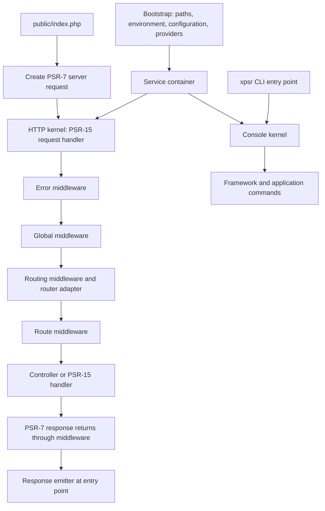

# XPSR framework completion plan

Prepared on 26 October 2026 from the working tree, including the unfinished namespace migration. The user accepted this proposal and all default decisions on 26 October 2026. The APIs, commands, and package names below describe the target; consult `IMPLEMENTATION_STATUS.md` for delivered work.

**Direction:** Build a small PHP framework with a PSR-based HTTP core, interchangeable integrations, and a convenient application skeleton. Keep XPSR's own application lifecycle, routing API, service providers, commands, and developer experience. Use existing implementations where that reduces maintenance without limiting those choices.

## 1. What exists and what needs repair

The project already contains an application bootstrap, a custom container with autowiring and deferred service registries, configuration loading, a Sunrise routing integration, Twig rendering, exception rendering, and response emission. These are a useful starting point, but the current tree is a prototype undergoing a refactor.

| Area | Evidence in the current project | Work needed |
| --- | --- | --- |
| Namespace migration | `composer.json` and `src/Crystoline/` use `Crystoline\`; helpers, configuration, and some application classes still reference `Crystoline\Xpsr\` | Complete one consistent namespace and regenerate autoloading. |
| PHP baseline | Composer declares `^7.0`; source uses typed properties and `mixed`; Docker uses PHP 7.4 | Choose a supported PHP baseline and align source, dependency constraints, Docker, and CI. `^7.0` also excludes PHP 8. |
| Application lifecycle | `Application` extends `ServiceContainer`, uses a static instance, creates an HTTP request before checking CLI, emits output, and calls `exit` | Separate bootstrapping, HTTP handling, console handling, and process output. |
| Routing | `Routing/Router.php` wraps Sunrise, but the registry and route files directly use Sunrise classes | Make route definitions, matching results, middleware execution, and URL generation independent of the vendor. |
| Container | `has()` calls `resolve()`, which invokes factories; scalar values are reflected as class names; constructor resolution reads `$_SESSION` | Define resolution rules and test PSR-11 behavior, lifetimes, defaults, and failure modes. |
| HTTP messages | The custom `ServerRequest` has unimplemented methods and returns arrays from some `with*()` methods; `RequestTrait` references missing `Uri` and `Stream` classes | Use an established PSR-7 implementation for the framework runtime. Retain custom messages only if maintained as a separately tested component. |
| Request factories | The active server-request factory delegates to Sunrise. The separate `HttpRequestFactory` passes `$_POST` as the HTTP method | Separate creation from globals from PSR-17 factories; remove or repair the unused alternate path. |
| Error handling | HTML exceptions always use Whoops; JSON rendering also goes through Whoops; `shouldReport()` always returns false | Add production error responses and PSR-3 reporting, with explicit development-only diagnostics. |
| Configuration and paths | `getEnvironment()` returns `null` before reading `APP_ENV`; includes and route resources use relative paths | Resolve paths from an explicit base directory and test environment overrides. |
| Console | `Application::handleCommand()` is empty; there is no project CLI entry point | Add an independent console kernel and XPSR commands. |
| Views and sessions | Twig debug is hard-coded on and caching off; session middleware currently just forwards the request | Make view options configurable; finish session behavior in the optional web integration. |
| Quality tooling | Composer scripts mention PHPUnit and PHPCS without declaring development dependencies; no test suite or CI configuration was found | Establish executable tests, static analysis, formatting, and CI. |
| Distribution | Framework source and example application share a `type: project` package; `composer.lock` is ignored and untracked | Separate reusable framework code from the installable application skeleton when the API stabilizes. |
| Local serving | Docker serves `/var/www/html` without configuring `public/` as the document root; `serve-docker` says `docker composer`; old application rewrite rules remain | Provide and verify a clean development setup for the skeleton. |

**Checks performed:** Composer validation passed with `--strict --no-check-publish --no-plugins --no-scripts`. All 37 application/framework PHP files passed syntax checks under the available WSL PHP 8.2.28 runtime. Small in-memory probes confirmed that `has()` runs a factory, retrieving a scalar binding fails, custom request construction fails on the missing `Uri`, and application construction fails on the old namespace. The probes added the new namespace to the autoloader in memory; no generated autoload files were changed. These checks do not establish end-to-end HTTP behavior or PSR conformance.

## 2. Standards policy

Aim for useful interoperability rather than implementing every PSR yourself. Requiring a PSR package or declaring an interface is only the starting point: behavior must satisfy the contract.

There is currently **no accepted PSR router interface**, nor an accepted PSR console-command, service-provider, template, or ORM interface. PSR-7 and PSR-15 allow routing components to participate in HTTP processing, but do not standardize route registration or named URL generation. Those need XPSR contracts. See the [PHP-FIG standards index](https://www.php-fig.org/psr/).

| Standard | Proposed role | Delivery |
| --- | --- | --- |
| PSR-4 | Composer autoloading for framework, application, integrations, and tests | Foundation |
| PSR-1 + PER Coding Style | Consistent source formatting; PER extends and replaces PSR-12 | Foundation |
| PSR-11 | Container consumption and container exception contracts | Foundation |
| PSR-7 | Request, response, URI, stream, and uploaded-file boundaries | HTTP core |
| PSR-17 | HTTP object factories injected into framework services | HTTP core |
| PSR-15 | HTTP kernel, middleware, and request handlers | HTTP core |
| PSR-3 | Logging and exception reporting, with a default null logger | HTTP core |
| PSR-16 | Simple caching integration | Optional services |
| PSR-6 | Cache pools when an integration needs pool semantics | Optional services |
| PSR-14 | Event dispatching, listener discovery, and stoppable-event behavior | Optional services |
| PSR-18 | Outgoing HTTP client integration | Optional services |
| PSR-20 | Injectable time for expiration and other time-dependent behavior | When needed by services |
| PSR-13 | Hypermedia links for applications that need them | Later, optional |

Use direct Composer requirements for interfaces the package actually imports; do not rely on transitive dependencies. Choose and document supported interface-package major versions, then test them against every supported adapter. Do not assume the current Sunrise versions work with newer PSR interface majors.

The relevant contracts are described by [PSR-7](https://www.php-fig.org/psr/psr-7/), [PSR-11](https://www.php-fig.org/psr/psr-11/), [PSR-15](https://www.php-fig.org/psr/psr-15/), and [PSR-17](https://www.php-fig.org/psr/psr-17/). Use the [PER coding style](https://www.php-fig.org/per/coding-style/) with a compatible formatter.

**Recommended baseline:** PHP 8.4 or newer, initially tested on PHP 8.4 and 8.5. This is a proposed project policy, not something already validated here. PHP 8.4 has security support through December 2028; the available local PHP 8.2 runtime is approaching its December 2026 support end. Upgrade the development runtime before establishing the new CI baseline. If intended hosting requires PHP 8.3, explicitly choose that broader support range before implementation. See [PHP's support schedule](https://www.php.net/supported-versions.php).

## 3. Application architecture

Prefer composition: the application holds a container rather than inheriting its implementation. Runtime services receive their dependencies through constructors; restrict container lookups to factories, bootstrapping, and handler resolution. Existing global helpers can remain conveniences, but framework internals should not require the static application singleton.



Bootstrap runs before request handling. A minimal entry-point fallback must handle bootstrap failures, since HTTP error middleware cannot catch failures that occur before it exists.

| Component | Responsibility |
| --- | --- |
| `Application` / builder | Own base paths, configuration, service registration, and the boot lifecycle. |
| `HttpKernel` | Implement PSR-15 `handle(ServerRequestInterface): ResponseInterface`; support repeated calls without leaking request state. |
| Middleware pipeline | Run global and route middleware in a documented order, supporting short-circuit responses. |
| `ConsoleKernel` | Register commands and return an exit code without creating an HTTP request or starting a session. |
| Service providers | Register definitions first; boot only after all providers have registered. Deferred providers load once. |
| HTTP factories | Provide PSR-17 interfaces; keep parsing PHP globals in a separate request-creation integration. |
| Response emitter | Write status, headers, and body only at the HTTP entry point. |
| Response helpers | Build JSON, HTML, redirects, and empty responses using PSR-17 response and stream factories. |
| Handler resolver | Resolve controllers and PSR-15 handlers without depending on a routing vendor. |

Start with synchronous request processing. Avoid request objects in shared singleton services. Worker servers, async execution, and hot reloading can be later integrations after lifecycle/reset semantics are tested.

**Container policy:** Keep and improve the custom container if it is part of XPSR's intended identity. PSR-11 standardizes `get()` and `has()`, not `bind()`, autowiring, or provider registration. Use a separate XPSR registration/builder contract for those operations. Consumers should accept `Psr\Container\ContainerInterface`; replacing the container's builder requires an integration, not just a PSR-11 implementation.

Before expanding autowiring, specify explicit factory versus service bindings, aliases, instances, transient/shared lifetimes, rebinding behavior, scalar configuration, nullable/default arguments, and descriptive circular-dependency errors. Do not implicitly invoke every invokable service. An invokable controller must remain a controller until the handler resolver invokes it. Make `has()` free of service-construction side effects as an XPSR guarantee; that is an additional design choice, not an explicit PSR-11 requirement.

## 4. Interchangeable routing

There are two useful compatibility levels:

1. **HTTP compatibility:** mount any PSR-15 handler or middleware in the pipeline. A third-party router may integrate at this level while retaining its own route syntax.
2. **Portable XPSR routing:** use an adapter that consumes XPSR route definitions and returns XPSR match results. Applications can then switch adapters without rewriting supported routes. A PSR-7-aware router alone does not guarantee this level.

The existing `dispatch()` wrapper covers only response dispatch. Expand the design to separate route matching from controller invocation and middleware execution. [Mezzio's routing adapters](https://docs.mezzio.dev/mezzio/v3/features/router/intro/) provide a useful precedent for this separation.

**Proposed contracts and objects:**

```php
interface RouterInterface
{
    public function match(ServerRequestInterface $request): RouteMatch;
}

interface UrlGeneratorInterface
{
    public function generate(
        string $name,
        array $parameters = [],
        array $query = [],
    ): string;
}
```

These are API sketches. `ServerRequestInterface` is PSR-7; `RouteMatch` and the routing interfaces belong to XPSR. Do not add vendor types to these public signatures.

- `RouteDefinition`: name, supported methods, path template, handler, middleware, defaults, and parameter constraints.
- `RouteCollection`: the framework-owned registry used by route loading, adapters, URL generation, and `route:list`.
- `RouteMatch`: matched definition and parameters, or a distinct not-found/method-not-allowed result carrying allowed methods.
- Adapter factory: builds the vendor matcher from the collection after route registration. Matching does not invoke controllers.
- Routing middleware: attaches the result and parameters to the request; handles 404/405 consistently.
- Dispatch handler: resolves the route's handler and executes its middleware through the common pipeline.

**Proposed route declaration:**

```php
use App\Http\Controller\HomeController;
use Crystoline\Routing\RouteCollection;

return static function (RouteCollection $routes): void {
    $routes->get('/', [HomeController::class, 'index'])->name('home');
};
```

Define a small portable feature set first: methods, static paths, named path parameters, simple constraints, names, prefixes, and middleware groups. XPSR expands groups before giving definitions to adapters. Define matching precedence and parameter encoding explicitly. Avoid promising that arbitrary vendor-specific regular expressions, optional-segment syntax, or host matching will translate automatically.

Keep named URL generation based on the same portable definitions, or delegate through a separate adapter implementing the URL contract. Fail clearly for missing required parameters, duplicate names, or unsupported route features. Do not expose `getUnderlyingRouter()` as the normal application API; any vendor extension should be explicitly documented as reducing portability.

| Adapter | Proposed order | Notes |
| --- | --- | --- |
| Sunrise | First, to preserve the existing example behavior | Prototype against the chosen PHP/PSR versions. Adapt matching and metadata; do not let its pipeline execute route middleware a second time. |
| FastRoute | Second, to prove interchangeability | Its method/URI dispatcher needs a PSR-7 adapter and separate URL generation. Proposed default for new projects once parity tests pass. |
| Symfony Routing | Later optional integration | Translate match context, exceptions, and generation behavior; test the portable subset. |
| User-provided | Documented extension path | Supply the matcher, factory/provider, and any URL-generation integration, then run the shared adapter contract suite. |

[FastRoute's documentation](https://github.com/nikic/FastRoute) describes its dispatcher model. Existing Sunrise behavior was inspected in the installed vendor code; current library releases and compatibility must be evaluated during the adapter prototype. Do not offer an adapter in the installer until it passes the compatibility matrix.

**Routing completion gate:** the same route files and controllers pass the same tests with both Sunrise and FastRoute. Changing the selected provider/adapter and installed dependency is sufficient. Tests cover parameters, constraints, groups, route middleware order, short-circuiting, 404, 405 with `Allow`, explicit and implicit HEAD behavior, OPTIONS policy, named URL generation, encoding, and invalid route definitions.

## 5. XPSR commands and installation

Build XPSR's command experience on the standalone Symfony Console component. It provides input parsing, output, help, and testing support while XPSR owns command names, registration, generators, and behavior. It can be used outside the Symfony framework; see [Symfony Console documentation](https://symfony.com/doc/current/console.html).

Use a project-root `xpsr` executable and an `app/Console/Commands/` directory. Register application/package commands explicitly through providers initially. Add convention-based discovery only if needed and cache its results. Commands receive services by dependency injection and return conventional exit codes; errors go to stderr.

| Command | Purpose | Delivery |
| --- | --- | --- |
| `php xpsr list`, `help`, `about` | Discover commands and inspect version/environment | Console foundation |
| `php xpsr serve` | Run a local development server with `public/` as document root | Console foundation |
| `php xpsr route:list` | Inspect the common route collection, regardless of adapter | Console foundation |
| `php xpsr make:controller`, `make:middleware`, `make:command`, `make:provider` | Generate application code from XPSR stubs | Developer tooling |
| `php xpsr config:cache`, `config:clear` | Build and invalidate deployment configuration | After configuration becomes cacheable |
| `php xpsr route:cache`, `route:clear` | Cache route metadata where supported | After routing contract stability |
| `php xpsr cache:clear` | Clear the configured application cache | Optional cache integration |
| `php xpsr migrate`, `queue:work`, `schedule:run` | Commands contributed by their respective integrations | Later modules |

Keep generator targets inside the application directory and report existing-file conflicts. Support non-interactive usage. Do not add cache commands that appear to succeed while ignoring uncacheable closures or runtime objects. The current closure-based factory configuration needs a separate policy: keep factories as executable definitions, or move them to provider classes, rather than serializing them into a configuration cache.

**Proposed installation experience:**

```text
composer create-project crystoline/xpsr my-app
cd my-app
php xpsr setup --router=fastroute --no-interaction

# Later, a standalone installer could combine the steps:
xpsr new my-app --router=fastroute --preset=web --no-interaction
```

These are target workflows, not commands available in the current project. Initially ship a working default skeleton; add the explicit setup step for alternative choices after the CLI and adapters work.

The setup command/installer should:

1. Offer only tested adapters, plus a documented manual/custom integration path.
2. Select an optional `web` or `api` preset. Start with one proven HTTP-message implementation; add more selectable implementations after testing them.
3. Install only the selected optional adapter dependencies and write explicit provider/configuration choices.
4. Create environment/configuration files without replacing existing application files, then run a bootstrap check.
5. Support deterministic flags in CI and report a dependency-resolution failure without leaving a success-looking configuration.

Perform Composer dependency changes as a separate installer/setup operation, not by recursively invoking Composer from an active install hook. Root skeleton scripts can initialize files, but dependencies' Composer scripts do not automatically execute. See [Composer's script behavior](https://getcomposer.org/doc/articles/scripts.md).

## 6. Package and directory boundaries

Develop in the current repository first. Establish internal boundaries before creating many independently released packages. By the first reusable release, separate the framework library from the application skeleton and make router integrations optional dependencies.

Proposed package names, subject to availability:

| Package | Contents |
| --- | --- |
| `crystoline/xpsr` | Application skeleton: `app/`, `bootstrap/`, `config/`, `routes/`, `public/`, `views/`, CLI entry point, and development setup. |
| `crystoline/xpsr-framework` | Lifecycle, HTTP kernel, container, routing contracts, provider system, and initial console support. |
| `crystoline/xpsr-router-sunrise` / `crystoline/xpsr-router-fastroute` | Vendor-specific adapters and provider factories; depend on framework contracts and their router. |
| `crystoline/xpsr-installer` | Optional standalone `xpsr new` tool once setup behavior is stable. |

Keep contracts in the framework initially; extract a contracts package only if independent integrations need a separate release cycle. Twig and other optional integrations can begin as internal modules, then become packages when dependency isolation is useful. The framework library must not depend on application paths or the `App\` namespace. Commit the application skeleton's lockfile for reproducibility; test the library with both lowest and current allowed dependency versions.

Suggested internal layout:

```text
src/Crystoline/
  Contracts/
  Foundation/
  Container/
  Http/
    Middleware/
    Response/
  Routing/
  Console/
  Config/
  View/
tests/
  Unit/
  Integration/
  Contract/
  Fixtures/
docs/
```

Move existing classes incrementally rather than doing another large rename before behavior is covered. Consolidate the empty `ApplicationHandlerInterface`, the unused combined `RouteHandlerInterface`, and duplicate HTTP abstractions only after checking their consumers.

## 7. Delivery roadmap and acceptance criteria

Each phase produces a usable checkpoint. Tests accompany the behavior in that phase; they are not a final cleanup stage.

| Phase | Implementation work | Completion gate |
| --- | --- | --- |
| **0. Restore a reproducible baseline** | Finish namespace migration; fix base paths and environment selection; choose PHP baseline; align Docker and Composer; declare test/static-analysis/style tooling; add smoke tests. | Clean install works on declared PHP versions. `/` and `/hello` work through the front controller. Bootstrap is independent of the shell working directory. CI runs meaningful tests. |
| **1. Establish core lifecycle and DI rules** | Separate application/container ownership; define provider register/boot order; fix container semantics, factory handling, defaults, cycles, and deferred registration; introduce an HTTP kernel returning a response. | Kernel is callable in tests without `exit`, headers, or global request input. Provider boot is deterministic. Container contract/behavior tests pass. A second request does not reuse the first request's state. |
| **2. Finish the PSR HTTP pipeline** | Add global/route middleware infrastructure; inject PSR-17 factories; use a working PSR-7 implementation; centralize error middleware, PSR-3 reporting, response helpers, and emission. | Tests cover middleware order/short circuits, requests and responses, production/debug errors, body parsing, repeated headers, streamed responses, and empty/HEAD responses. |
| **3. Make routing portable** | Add route definitions/collection/results; migrate existing routes; build Sunrise adapter and FastRoute adapter; implement shared dispatch and named URLs. | Both adapters pass the shared routing suite with unchanged application route/controller fixtures. Unsupported features fail clearly. |
| **4. Deliver CLI and installation choices** | Implement console kernel, project executable, command registration, initial commands and generators; add explicit setup/installer choices. | CLI starts without HTTP globals or sessions. Generated code runs. Fresh projects using either supported adapter boot and show the same routes. Non-interactive installation is tested. |
| **5. Package and document the first release** | Separate library/skeleton and optional adapters; finish dependency constraints, README, tutorials, upgrade policy, examples, release automation, and production configuration. | A user can install the released skeleton, build an endpoint and command, switch adapters, run tests, and deploy using only documented steps. |
| **6. Expand through optional services** | Cache, events, clock, outgoing HTTP client, fuller sessions/CSRF, validation, database integration/migrations, authentication, queues, and scheduling. | Each module has its own interface/integration tests and can be omitted without breaking an API-only application. |

**Suggested first implementation slice:** restore the namespace and path baseline, add a failing/passing bootstrap test, then introduce `HttpKernel::handle()` with one JSON endpoint and one middleware test. Keep the current router during this slice. This establishes a testable request lifecycle before designing the second adapter or installer.

**First public alpha scope:** phases 0–5 with two routing adapters, PSR-7/11/15/17 boundaries, PSR-3 logging, providers, configuration, basic CLI/generators, a usable skeleton, and documentation. Do not make an ORM, authentication system, scheduler, or queue engine prerequisites for this alpha. Make clear which optional standards are not implemented yet.

## 8. Verification and release requirements

- **Container:** known/missing/null/scalar entries; factory and instance bindings; aliases; singleton identity; rebinding; constructor defaults and nullable parameters; unsupported type diagnostics; circular dependency paths; deferred providers; correct exception interfaces.
- **HTTP:** handle requests without PHP globals; test two message implementations before claiming implementation interchangeability; exercise request attributes/immutability, body parsing, response factories, error negotiation, no debug disclosure in production, and logging without exposing secrets.
- **Routing:** run the same contract suite for every selectable adapter, including name/parameter generation and all status/middleware behaviors listed above. Document the portable route grammar and escaping rules.
- **CLI:** help, arguments/options, status codes, stderr, container-injected commands, generators, and CLI boot without constructing an HTTP request.
- **Installer/distribution:** fresh project creation, each router choice, dependency conflicts, missing required packages, failure cleanup, path names containing spaces, and a downstream application using the framework as a Composer dependency.
- **Deployment:** document root is `public/`; environment overrides work; debug is off by default; writable cache directories are documented; only configured proxies/hosts are trusted; session/CSRF behavior is explicit when the web integration is enabled.
- **CI:** Composer validation, syntax checks, unit/integration/adapter contract suites, static analysis, formatting checks, and dependency auditing. Keep coverage reporting separate from the basic test command so a missing coverage driver does not prevent tests.

Document each supported PHP/dependency combination, version public APIs semantically, and provide migration notes for intentional breaks. Track any retained third-party code and its required notices alongside the project's license.

## 9. Accepted decisions

The user accepted all of these defaults on 26 October 2026:

| Decision | Recommended default |
| --- | --- |
| PHP support | PHP 8.4+, initially test 8.4 and 8.5. |
| Namespace | Finish the current `Crystoline\` migration; avoid another immediate rename. |
| Container | Keep the custom implementation, harden it, and keep runtime consumers on PSR-11. |
| Routing | One portable XPSR route API; Sunrise for migration, FastRoute as the second adapter and eventual new-project default after tests. |
| HTTP messages | Use a maintained PSR-7/17 implementation; choose exact package versions after the compatibility prototype. |
| Console | XPSR commands backed by standalone Symfony Console. |
| Distribution | One development repository initially; library + skeleton + optional adapters by the first reusable release. |
| Product focus | Lightweight web/API framework with explicit integrations; additional application services arrive as modules. |

Later decisions, 28 October 2026:

| Decision | Choice |
| --- | --- |
| Conventions | XPSR is not modeled on Laravel. Folder layout, file names, and helpers are chosen on their merits, and a Laravel convention is kept only when it is the better option. The skeleton stays flat: `app/`, `config/`, `routes/`, `views/`, `public/`, `migrations/`, and `var/` for runtime files. |
| Namespace | `Crystoline\Xpsr\` replaces `Crystoline\` (the 26 October choice), from 0.2.0. The framework owns the root of `Crystoline\Xpsr\`; each package takes a sub-namespace such as `Crystoline\Xpsr\Cache\`. This leaves the vendor namespace free for other projects and matches the `crystoline/xpsr-*` package names. |
| Migrations | Files live in `migrations/` at the project root, named `<YYYYMMDDHHMMSS>_<name>.php` in UTC, and return an anonymous `Migration` subclass so that names never collide. |
| Monolog logging | Package `crystoline/xpsr-log-monolog`. `LOG_CHANNEL`: `stderr` (default), `file` (`var/log/app.log`), `daily` (14 files kept), or `syslog`. `LOG_FORMAT`: `line`, or `json`, the default in production. `LOG_LEVEL` as before. A request ID from a valid `X-Request-Id` header, or generated, is added to every log line and echoed on the response. Without the package, the `error_log` logger stays. |
| Rate limiting | In `crystoline/xpsr-cache`, on `symfony/rate-limiter` with a sliding window. Named limits in `config/rate_limit.php`; a limit is attached to routes or groups with `->middleware(RateLimit::named('login'))`, or applied to every request through `app.middleware`. Clients are counted by IP, resolved through the trusted proxies; a per-limit key resolver allows other identities later. Over the limit: 429 with `Retry-After`; `X-RateLimit-Limit` and `X-RateLimit-Remaining` on every response. State is kept in the application cache. |
| Validation | `Crystoline\Xpsr\Validation\ValidatorInterface` and the request mapping in the framework; Symfony Validator in `crystoline/xpsr-validation`. Input classes (constructor parameters are fields, `#[Assert\…]` rules) and `validateArray()`. 422 with `{"message", "errors": {field: [messages]}}`. Sources: body, query, route. English messages. `#[Field('due_at')]` and `#[Input(naming: 'snake')]`. Filters before conversion and validation (`Trim`, `Lowercase`, `Uppercase`, `EmptyToNull`, `Replace`, custom `#[Filter]`), class defaults with per-field opt-out; no sanitizing filters. `make:input` writes to `app/Http/Input`. |
| Sessions and CSRF | XPSR's own PSR-15 session layer, not PHP's `session_start()` or Symfony's HttpFoundation sessions. Stores: `file` (default, `var/sessions`), `cache`, `database` (table from `make:session-table`), and `array` for tests. Values are JSON data only. Cookie `xpsr_session`: HttpOnly, `SameSite=Lax`, Secure on HTTPS requests; a session and its cookie exist only once something is stored. IDs from the browser are used only when the store knows them. CSRF tokens in a `_token` form field (`csrf_field()`) or the `X-CSRF-Token` header (`csrf_token()`). `SessionMiddleware` and `CsrfMiddleware` apply to the `routes/web.php` group; API routes have neither. Every unsafe request in that group needs the token, so login forms are protected too. |
| Authentication | Contracts, session sign-in, password hashing, middleware, and policies in the framework (`Crystoline\Xpsr\Auth\`). Guards per `auth.guards`: `web` on the session; `api` on `AUTH_API_DRIVER`, `jwt` by default (package `crystoline/xpsr-auth-jwt`, `lcobucci/jwt`, HS256 by default, RS256/ES256 possible) or `token` (revocable, SHA-256-hashed tokens in a table, `crystoline/xpsr-database`). Users from a provider: a table (`database`), Doctrine entities (`doctrine`), or the application's own. Passwords with Argon2id when available, otherwise bcrypt, upgraded at sign-in. `Authenticate` (401 or the login page), `Guest`, `RequireScopes`; login throttling with the rate limiter. Policies per model class with `before()` and `Gate::authorize()` (403); `auth_user()` and `can()` in views. Not included: registration, password reset, email verification, social login, two-factor, remember-me. |
| Eloquent adapter | Package `crystoline/xpsr-orm-eloquent` with `illuminate/database` 12 and `illuminate/events` (model events). Models run on the PDO of XPSR's DBAL connection of the same name; Eloquent's transactions go through DBAL, which nests them with savepoints, so both nest either way and share test rollbacks. XPSR's migrations only: Eloquent's migrations and schema builder are not offered, so every database adapter shares one set of migration commands. `make:model` writes to `app/Model/` (`App\Model\`), matching `app/Entity/` for Doctrine. Users through the `eloquent` driver and the `Authenticatable` trait. |
| Doctrine ORM adapter | Entities in `app/Entity/` (`App\Entity\…`) with attribute mapping; no proxy classes, using PHP 8.4 native lazy objects; metadata cache from `crystoline/xpsr-cache` when installed, otherwise memory; schema changes through `make:migration --diff`, which writes ordinary XPSR migrations; package `crystoline/xpsr-orm-doctrine`. Columns default to snake case (`orm.naming`). |

If maintaining a completely independent HTTP-message or console implementation is an explicit project goal, treat it as an additional component with its own specification and tests. It should not block completion of the framework lifecycle and routing design.

## 10. Extensible integrations and planned components

Agreed on 28 October 2026. This section plans work that is not implemented yet, except where it says so.

### The rule for integrations

Every component follows the router's model: **XPSR owns a small contract, the configuration, the console commands, and a shared contract test suite; adapters wrap mature libraries and must pass that suite.** Applications choose an adapter the way they choose a router, with `composer require` and a provider line, or with `php xpsr setup`.

Where a PSR exists, it already provides the portability, and the "adapter" is only a choice of implementation: cache (PSR-16 and PSR-6), the HTTP client (PSR-18), events (PSR-14), logging (PSR-3), and the clock (PSR-20). Where no common API can exist, as with ORMs, XPSR does not wrap the library's API. The adapter integrates it (configuration, container, connection sharing, commands, request lifecycle, testing) and application code uses the library directly.

### Database and ORM adapters

```text
crystoline/xpsr-database          foundation: connections, migrations, contracts, test helpers
├── crystoline/xpsr-orm-doctrine  Doctrine ORM adapter (first)
├── crystoline/xpsr-orm-eloquent  Eloquent adapter (second)
└── crystoline/xpsr-orm-cycle     Cycle ORM adapter (later, if wanted)
```

- **Foundation (implemented).** `crystoline/xpsr-database` keeps Doctrine DBAL as the one connection layer: DBAL already hides the differences between database servers, and a second abstraction over the DBAL, Illuminate, and Cycle query builders would be a weaker DBAL. One configuration and one connection per name, shared by every adapter, so the ORM, plain queries, and test rollbacks see the same transaction. The migrate commands talk only to `MigratorInterface`, selected with `database.migrations.runner`; `DatabaseTransactions` wraps tests in transactions; `MigratorContractTestCase` is the runner contract suite.
- **Doctrine ORM adapter (implemented, twentieth milestone).** Builds the `EntityManager` on XPSR's DBAL connection, with attribute mapping from `app/Entity` and native lazy objects instead of proxies. `ClearEntityManagerMiddleware` clears it after each request for worker servers. Schema changes go through `make:migration --diff`; a Doctrine Migrations runner through `MigratorFactoryInterface` remains possible later.
- **Eloquent adapter.** Configures `illuminate/database` on the PDO of XPSR's connection, so transactions stay shared. Optionally provides a runner for Eloquent-style migrations. Check compatibility with the `illuminate/*` versions the framework already uses.
- **Cycle ORM adapter.** Only if requested: Cycle opens its own connections, so sharing transactions needs more work.
- **ORM contract suite (implemented).** `Testing\OrmAdapterContractTestCase`: every ORM adapter must show that it uses XPSR's connection (its writes are visible to DBAL inside the same transaction and undone by a rollback), reads what plain queries wrote, and resets its state between requests.
- **Choosing.** `php xpsr setup --orm=doctrine|eloquent|none`, like `--router`: installs the package, adds the provider, and writes the configuration.

### Planned components, in order

| Order | Component | Approach | Open decisions |
|---|---|---|---|
| 1 | Doctrine ORM adapter | Done; see section 9 for the accepted choices. | — |
| 2 | Eloquent adapter | Done (twenty-sixth milestone); see section 9. | — |
| 3 | CORS middleware | Done (twenty-first milestone): `CorsMiddleware` in the framework, `config/cors.php`. | — |
| 4 | Monolog logging | Done (twenty-second milestone): `crystoline/xpsr-log-monolog`; see section 9. | — |
| 5 | Clock (PSR-20) | Done (twenty-first milestone): in the framework, `symfony/clock`, `freezeTime()` for tests. | — |
| 6 | Rate limiting | Done (twenty-second milestone): in `crystoline/xpsr-cache`; see section 9. | — |
| 7 | Validation | Done (twenty-third milestone); see section 9. | — |
| 8 | Authentication and authorization | Done (twenty-fifth milestone); see section 9. | — |
| 9 | Sessions, cookies, and CSRF | Done (twenty-fourth milestone); see section 9. | — |
| 10 | Queues and jobs | Wrap Symfony Messenger (database, Redis, AMQP, SQS transports) rather than build an engine; `php xpsr queue:work`. | Job API; failure handling and retries. |
| 11 | Mail | `symfony/mailer`, configured by a DSN. | Templates through the view layer. |
| 12 | Scheduler | `php xpsr schedule:run` from one cron entry. | Own small scheduler or `symfony/scheduler`. |
| 13 | File storage | `league/flysystem`: local, S3, and others. | Disk configuration format. |
| 14 | View adapters | `ViewHandlerInterface` exists; add Plates or Latte next to Twig, with a contract suite, as Sunrise sits next to FastRoute. | Which engines are wanted. |

Before each component starts, its open decisions are settled with the user and recorded in section 9.
